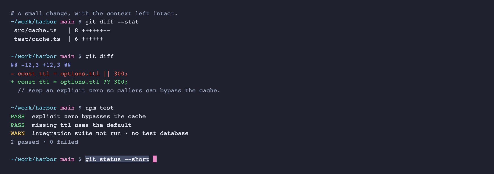
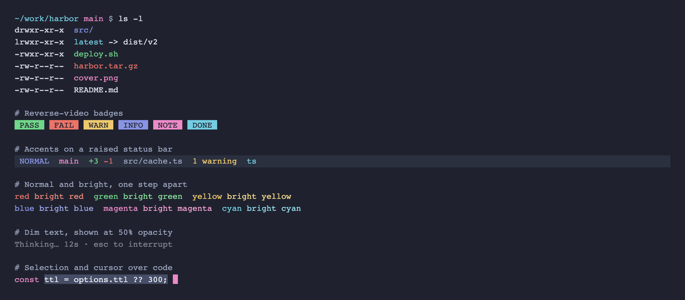
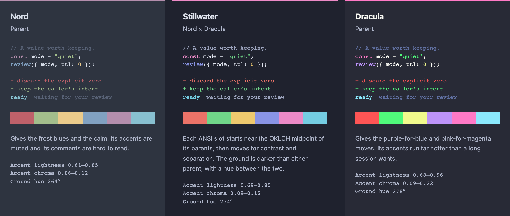

# Stillwater

A quiet, dark terminal theme for long sessions, blended from [Nord](https://www.nordtheme.com/) and [Dracula](https://draculatheme.com/).



*Rendered from the HTML guide in this repo, which approximates a terminal.*

- **A darker ground.** Indigo-slate, darker than either parent, with a hue between them.
- **Color from both parents.** ANSI blue becomes periwinkle and magenta becomes orchid, the same move Dracula makes with less chroma. Cyan stays close to Nord's frost.
- **Accents you can tell apart.** They sit at different lightness levels, so they stay distinct when hue alone isn't enough.
- **Comments you can read.** ANSI 8 reaches 6.46:1 on the background.
- **One loud thing.** The orchid block cursor is easy to find on a busy screen.

## Install

The theme is one [Ghostty-format](https://ghostty.org/docs/features/theme) file, [`themes/Stillwater`](themes/Stillwater). It sets terminal colors only and leaves fonts, opacity, and key bindings alone.

### Ghostty

```sh
mkdir -p ~/.config/ghostty/themes
cp themes/Stillwater ~/.config/ghostty/themes/
```

Then add this line to your Ghostty config:

```
theme = Stillwater
```

### Rex

Find your app's label with `rex client ls`, then run this from the repo directory:

```sh
rex -C CLIENT do client.theme.import path="$PWD/themes/Stillwater"
```

Importing also selects the theme, so note your current one first. To switch back, use **Change Theme…** in the command palette.

## Palette

| Role | Hex | | ANSI | Normal | Bright |
| --- | --- | --- | --- | --- | --- |
| Background | `#1f222e` | | Black | `#2b303f` | `#9da5bf` |
| Foreground | `#dfe3ed` | | Red | `#ec7368` | `#f38a7f` |
| Cursor | `#ec8ac7` | | Green | `#70d689` | `#89de9c` |
| Cursor text | `#1f222e` | | Yellow | `#eec96e` | `#f6da8e` |
| Selection | `#464d66` | | Blue | `#8994e5` | `#a2a9ee` |
| Selection text | `#eef0f6` | | Magenta | `#ec8ac7` | `#f5a3d4` |
| | | | Cyan | `#74cde2` | `#95dded` |
| | | | White | `#d5d9e4` | `#eef0f6` |

ANSI 0 doubles as the raised surface color, and ANSI 8 as the comment color. A terminal palette can't set an editor's syntax rules, so choose ANSI 8 or `#9da5bf` for comments there.

## Readability

| Pair | Contrast |
| --- | --- |
| Body text on background | 12.32:1 |
| Comments on background | 6.46:1 |
| Selected text | 7.33:1 |
| Lowest accent on background | 5.44:1 |
| Lowest accent on raised surface | 4.52:1 |

Ratios use the WCAG sRGB formula with opaque colors.



Known limits:

- **Truecolor apps ignore the palette.** Editors and agents that send their own colors won't pick up Stillwater unless they use ANSI colors or have a matching theme.
- **Dim text falls below 4.5:1.** At an estimated 50% fade, body text is about 4.18:1 and comments about 2.69:1. No comment color can fix that while staying quieter than body text.
- **ANSI 0 isn't for text.** It's a surface color at 1.20:1 on the background.
- **Some simulated color-vision pairs stay close.** Green and yellow under protanopia (3.2), and green and cyan under tritanopia (2.7), measured as OKLab distance × 100.
- **Contrast isn't comfort.** These checks can't prove how a theme feels after a long session.

## Between its parents



## Guide

Open `index.html` in a browser for live specimens, every swatch, the full contrast and separation tables, and this comparison. It works offline, with no server, build step, or dependencies.

## Development

`palette.js` is the source of truth. `themes/Stillwater` is generated from it, so don't edit that file by hand. Keep the default colors in `guide.css` in sync; the tests check them.

```sh
node scripts/export-themes.cjs      # regenerate the theme file
node --test tests/palette.test.cjs  # needs Node.js 18 or later
```

The tests reject stale exports, contrast regressions, flattened accent lightness, and accents that merge under simulated color-vision deficiency.

Optional browser checks use Playwright and an installed Chromium-based browser. They default to Google Chrome on macOS; set `CHROME_PATH` for another.

```sh
npm install --prefix /tmp/stillwater-browser-check playwright
export PLAYWRIGHT_MODULE=/tmp/stillwater-browser-check/node_modules/playwright
node tests/browser.cjs
node tests/preview.cjs
```

If Ghostty is installed, you can validate the theme with its parser:

```sh
/Applications/Ghostty.app/Contents/MacOS/ghostty +validate-config --config-file="$PWD/themes/Stillwater"
```

## Credits

Built on the work of [Nord](https://www.nordtheme.com/) and [Dracula](https://draculatheme.com/). Stillwater is an independent theme, not an official variant of either. Parent values used for comparison come from the themes bundled with [Ghostty](https://ghostty.org/).

## License

[MIT](LICENSE)
