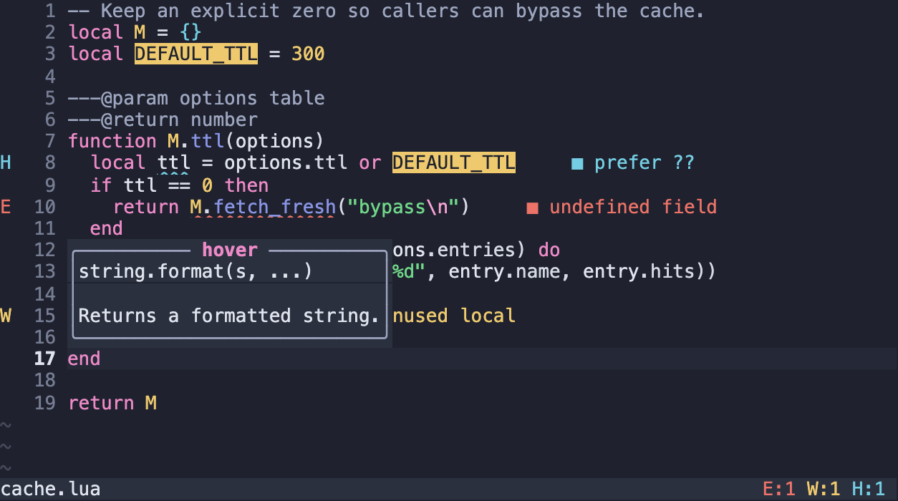
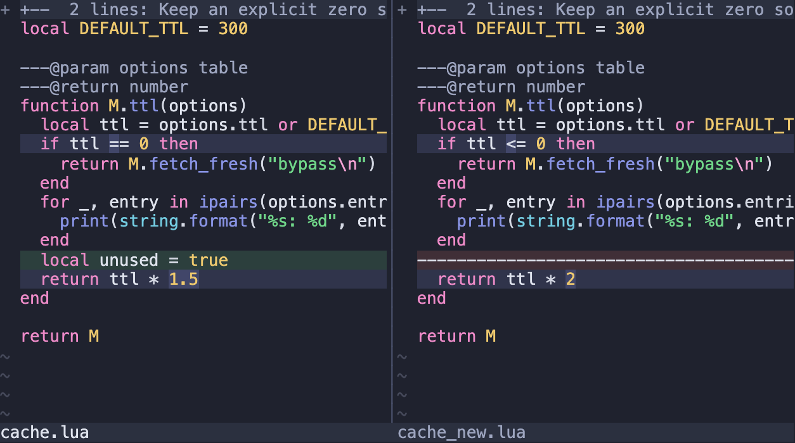

# Stillwater

A quiet, dark theme for terminals, Neovim, Orca, and Tern, made for long sessions and blended from [Nord](https://www.nordtheme.com/) and [Dracula](https://draculatheme.com/).


*Rendered from the HTML guide in this repo, which approximates a terminal.*

- **A darker ground.** Indigo-slate, darker than either parent, with a hue between them.
- **Color from both parents.** ANSI blue becomes periwinkle and magenta becomes orchid, the same move Dracula makes with less chroma. Cyan stays close to Nord's frost.
- **Accents you can tell apart.** They sit at different lightness levels, so they stay distinct when hue alone isn't enough.
- **Comments you can read.** ANSI 8 reaches 6.46:1 on the background.
- **One loud thing.** The orchid block cursor is easy to find on a busy screen.

## Install

Ghostty and Rex use one [Ghostty-format](https://ghostty.org/docs/features/theme) file, [`themes/Stillwater`](themes/Stillwater). Neovim and Orca use the plugins in this repo. Tern uses [`themes/tern/Stillwater.css`](themes/tern/Stillwater.css). These themes leave fonts, opacity, and key bindings alone.

### Ghostty

```sh
mkdir -p ~/.config/ghostty/themes
cp themes/Stillwater ~/.config/ghostty/themes/
```

Then add this line to your Ghostty config:

```
theme = Stillwater
```

### Rex

Find your app's label with `rex client ls`, then run this from the repo directory:

```sh
rex -C CLIENT do client.theme.import path="$PWD/themes/Stillwater"
```

Importing also selects the theme, so note your current one first. To switch back, use **Change Theme…** in the command palette.

### Tern

Tern uses a CSS theme, with no plugin or omp install needed. Tested with **Tern 0.9.11**. From this repo on macOS:

```sh
mkdir -p "$HOME/Library/Application Support/Tern/themes"
cp themes/tern/Stillwater.css "$HOME/Library/Application Support/Tern/themes/"
```

For other systems or a custom `TERN_CONFIG_DIR`, use the **Themes folder** shown in **Settings → Advanced**. The `themes` folder sits beside `settings.json`; create it if needed.

In **Settings → Appearance**, use **Dark** appearance and select **Stillwater** as the theme. You can also use **Change theme…** (⌃⌘T on macOS). Tern watches the folder, so no restart is needed. Copying the file does not select it or change your other settings.

The theme sets terminal, interface, and code syntax colors. It preserves all 16 ANSI colors, the orchid cursor, and the slate selection fill. Tern has no documented CSS token for selection text, so selected text keeps Tern's behavior. Native omp chat tokens and other app-specific colors not set by this file keep Tern's defaults.

To remove it, select your previous theme, then delete `Stillwater.css` from the themes folder. See [Tern's theme guide](https://docs.stencil.so/tern/guides/themes.html) for the format.

### Orca

Requires Orca **1.4.246 or later**. This repo is a data-only plugin: it supplies app, editor, and terminal colors, with no executable code or capabilities.

Clone or download the whole repo. From its directory, run:

```sh
orca plugin validate . --json
orca plugin dev load "$PWD" --json
```

If plugins are off, turn them on in **Settings → Plugins** first. Keep the repo at this path while it is loaded. Note your current app and terminal themes before switching:

1. Under **Settings → Appearance**, select **Stillwater** as the **Dark theme**, and use Dark mode to see it.
2. If you selected a separate dark editor theme, set it to **Stillwater** too.
3. Under **Settings → Terminal**, select **Stillwater** as the **Dark Theme**.

To remove the development plugin, first select your previous themes, then run `orca plugin dev unload "$PWD" --json` from the repo directory.

For terminal colors only, no plugin is needed: use **Settings → Terminal → Import from Ghostty → Choose File**, select `themes/Stillwater`, review the preview, then apply. This imports color overrides, not a named plugin theme.

Orca limits:

- The editor cursor and focus ring share orchid. Editor selection is an orchid tint; it cannot use the terminal's exact selection colors.
- Sidebar and chat settings that match the terminal can override app-theme colors. Trust dialogs keep Orca's own colors.
- Syntax uses Orca's supported TextMate scopes. It is not a full VS Code or Neovim highlight-group import.

### Neovim

Stillwater is also a Neovim colorscheme, and this repo is the plugin. With [lazy.nvim](https://github.com/folke/lazy.nvim):

```lua
{
  "heath0xFF/stillwater",
  lazy = false,
  priority = 1000,
  config = function()
    vim.cmd.colorscheme("stillwater")
  end,
}
```

For [lualine](https://github.com/nvim-lualine/lualine.nvim), set `theme = "stillwater"`. Two options are available, both off by default. Call `setup` before setting the colorscheme:

```lua
require("stillwater").setup({ italic_comments = true, transparent = true })
```



It covers Tree-sitter, LSP, diagnostics, and diffs, along with these plugins: blink.cmp, flash, gitsigns, indent-blankline, lazy, lualine, mason, neo-tree, noice, nvim-cmp, nvim-notify, nvim-tree, oil, telescope, trouble, which-key, and zen-mode.



## Palette

| Role | Hex | | ANSI | Normal | Bright |
| --- | --- | --- | --- | --- | --- |
| Background | `#1f222e` | | Black | `#2b303f` | `#9da5bf` |
| Foreground | `#dfe3ed` | | Red | `#ec7368` | `#f38a7f` |
| Cursor | `#ec8ac7` | | Green | `#70d689` | `#89de9c` |
| Cursor text | `#1f222e` | | Yellow | `#eec96e` | `#f6da8e` |
| Selection | `#464d66` | | Blue | `#8994e5` | `#a2a9ee` |
| Selection text | `#eef0f6` | | Magenta | `#ec8ac7` | `#f5a3d4` |
| | | | Cyan | `#74cde2` | `#95dded` |
| | | | White | `#d5d9e4` | `#eef0f6` |

ANSI 0 doubles as the raised surface color, and ANSI 8 as the comment color. A terminal palette can't set an editor's syntax rules, so choose ANSI 8 or `#9da5bf` for comments there.

## Readability

| Pair | Contrast |
| --- | --- |
| Body text on background | 12.32:1 |
| Comments on background | 6.46:1 |
| Selected text | 7.33:1 |
| Lowest accent on background | 5.44:1 |
| Lowest accent on raised surface | 4.52:1 |

Ratios use the WCAG sRGB formula with opaque colors.


Known limits:

- **Truecolor apps ignore the palette.** Editors and agents that send their own colors won't pick up Stillwater unless they use ANSI colors or have a matching theme.
- **Dim text falls below 4.5:1.** At an estimated 50% fade, body text is about 4.18:1 and comments about 2.69:1. No comment color can fix that while staying quieter than body text.
- **ANSI 0 isn't for text.** It's a surface color at 1.20:1 on the background.
- **Some simulated color-vision pairs stay close.** Green and yellow under protanopia (3.2), and green and cyan under tritanopia (2.7), measured as OKLab distance × 100.
- **Contrast isn't comfort.** These checks can't prove how a theme feels after a long session.

## Between its parents


## Guide

Open `index.html` in a browser for live specimens, every swatch, the full contrast and separation tables, and this comparison. It works offline, with no server, build step, or dependencies.

## Development

`palette.js` is the source of truth. `themes/Stillwater`, `themes/orca/*.json`, `themes/tern/Stillwater.css`, and `lua/stillwater/palette.lua` are generated from it, so don't edit those files by hand. Neovim highlight groups live in `lua/stillwater/highlights.lua`. Keep the default colors in `guide.css` in sync; the tests check them.

```sh
node scripts/export-themes.cjs  # regenerate the theme files
node --test tests/*.test.cjs    # needs Node.js 18 or later
```

The tests reject stale exports, contrast regressions, flattened accent lightness, and accents that merge under simulated color-vision deficiency. Orca tests also check all 22 terminal colors, app text and focus pairs, selection and diff tints, and syntax roles. If `nvim` is installed, they also load the colorscheme headlessly and check the contrast of its resolved highlights.

Tern tests check the generated CSS, ANSI and cursor values, selection fill, interface text, syntax roles, and white text on filled controls. Before release, load the CSS in Tern and check the terminal, theme picker, settings, code, and selections; text tests do not prove the rendered result.

With Orca installed, also run `orca plugin validate . --json` and `orca plugin inspect . --json`. These check the plugin without loading it or changing your theme. Before release, check the app, editor, terminal, menus, selections, and diffs in Orca; schema and contrast checks do not prove the rendered result.

Optional browser checks use Playwright and an installed Chromium-based browser. They default to Google Chrome on macOS; set `CHROME_PATH` for another.

```sh
npm install --prefix /tmp/stillwater-browser-check playwright
export PLAYWRIGHT_MODULE=/tmp/stillwater-browser-check/node_modules/playwright
node tests/browser.cjs
node tests/preview.cjs
```

If Ghostty is installed, you can validate the theme with its parser:

```sh
/Applications/Ghostty.app/Contents/MacOS/ghostty +validate-config --config-file="$PWD/themes/Stillwater"
```

## Credits

Built on the work of [Nord](https://www.nordtheme.com/) and [Dracula](https://draculatheme.com/). Stillwater is an independent theme, not an official variant of either. Parent values used for comparison come from the themes bundled with [Ghostty](https://ghostty.org/).

## License

[MIT](LICENSE)
